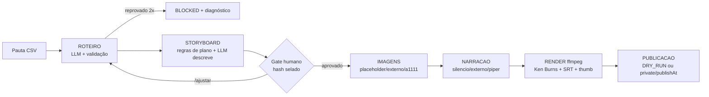

# Arquitetura

## Camadas
| Camada | Módulos | Responsabilidade |
|---|---|---|
| Conhecimento editorial | `prompts/*.md` | regras do canal, prompts, checklist de revisão — editáveis sem tocar no código |
| Orquestração | `vbp/pipeline.py`, `vbp/cli.py` | ordem das etapas, idempotência, gates, diagnóstico |
| Domínio | `script.py`, `storyboard.py`, `bible_refs.py`, `approval.py` | validação de roteiro, regras de enquadramento, referências, aprovação |
| Integrações | `llm.py`, `media.py`, `publish.py` | LLM (fallback/cache), ffmpeg, geradores de imagem/voz, YouTube, Telegram |
| Plataforma | `state.py`, `obs.py`, `budget.py`, `config.py` | SQLite, observabilidade, orçamento, configuração |

## Dados por episódio (`workspace/episodios/<ID>/`)
`roteiro.json|md` → `storyboard.json` → `imagens/cena_NNN.png` + `imagens/prompts.json` → `audio/cena_NNN.wav` +
`audio/textos.json` → `clipes/` → `video.mp4` (vídeo + áudio + legenda embutida) + `legendas.srt` + `thumbnail.png` →
`publish_plan.json`. Cada artefato principal tem `.explain.json`.

## Fronteiras de segurança
- Segredos só em variáveis de ambiente/.env (fora do Git); logs redigidos.
- Respostas de LLM são dados não confiáveis: sempre passam pela validação antes de virar artefato.
- Telegram aceita comandos só de chat IDs autorizados; offset persistido (idempotente).
- Publicação: exige `--live` + aprovação válida; envio sempre privado/agendado.

## Pontos de extensão
- Novo provedor de LLM: classe com `complete(prompt, temperature) -> str` + entrada em `build_providers`.
- Novo gerador de imagem/voz: novo ramo em `make_images` / `make_narration` (mantendo nomes `cena_NNN`).
- Novas regras de plano: `SHOT_RULES` (+ incrementar `STORYBOARD_RULES_VERSION`).
